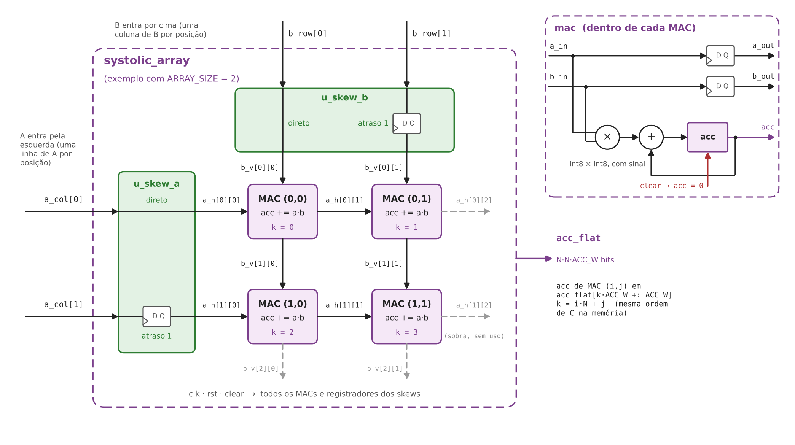

# Especificação do acelerador

[← voltar ao README](../README.md)

Este documento descreve a implementação RTL do núcleo de cálculo do acelerador: a unidade
MAC, o módulo de atraso escalonado (*skew*) e a malha sistólica parametrizável. A visão do
sistema (mapa de memória, registradores, protocolo e tiling) está em
[`especificacao.md`](especificacao.md).

| Módulo | Arquivo | Função |
|---|---|---|
| `mac` | [`rtl/accel/mac.v`](../rtl/accel/mac.v) | multiplica, acumula e repassa os operandos ao vizinho |
| `skew` | [`rtl/accel/skew.v`](../rtl/accel/skew.v) | atrasa a posição *i* da entrada em *i* ciclos |
| `systolic_array` | [`rtl/accel/systolic_array.v`](../rtl/accel/systolic_array.v) | malha `ARRAY_SIZE × ARRAY_SIZE` de MACs com os dois skews de borda |

## Visão geral



A malha calcula um bloco `S × S` de `C = A × B`, onde `S = ARRAY_SIZE`. A arquitetura é
**output-stationary**: cada MAC (*i*, *j*) guarda no seu acumulador o elemento `C[i][j]`
durante todo o cálculo, enquanto os operandos atravessam a malha:

- os elementos de **A** entram pela esquerda, uma linha de A por posição, e andam para a
  **direita**, de MAC em MAC;
- os elementos de **B** entram por cima, uma coluna de B por posição, e andam para **baixo**.

A cada ciclo, cada MAC multiplica o par que está recebendo, soma ao acumulador e repassa
os dois valores aos vizinhos. Assim, cada dado lido da memória é reutilizado por `S` MACs
sem ser lido de novo.

Para que `A[i][k]` e `B[k][j]` cheguem ao MAC (*i*, *j*) **no mesmo ciclo**, as entradas
passam antes por um atraso escalonado: a linha *i* de A entra *i* ciclos depois da linha 0,
e a coluna *j* de B entra *j* ciclos depois da coluna 0. Somando esse atraso ao tempo de
travessia pela malha, o elemento de índice *k* chega ao MAC (*i*, *j*) no ciclo `k + i + j`,
por qualquer um dos dois caminhos.

Exemplo para `S = 2`. Cada célula mostra qual índice *k* o MAC está multiplicando naquele
ciclo (`–` = recebe zero):

| Ciclo | MAC (0,0) | MAC (0,1) | MAC (1,0) | MAC (1,1) |
|---|---|---|---|---|
| 0 | k = 0 | – | – | – |
| 1 | k = 1 | k = 0 | k = 0 | – |
| 2 | k = 2 | k = 1 | k = 1 | k = 0 |
| … | … | … | … | … |
| K − 1 | k = K−1 | k = K−2 | k = K−2 | k = K−3 |
| K | – | k = K−1 | k = K−1 | k = K−2 |
| K + 1 | – | – | – | k = K−1 |

O último MAC, (`S−1`, `S−1`), recebe o último par no ciclo `K − 1 + 2(S − 1)`. Por isso uma
passagem completa leva **`K + 2·(S − 1)` ciclos**.

### Parâmetros

| Parâmetro | Padrão | Significado |
|---|---|---|
| `ARRAY_SIZE` | 4 | dimensão da malha (`S`); configurações previstas: 2, 4 e 8 |
| `DATA_W` | 8 | largura dos elementos de A e B (int8, com sinal) |
| `ACC_W` | 32 | largura do acumulador e dos elementos de C (int32, com sinal) |

No módulo `skew`, o número de posições se chama `N`. Na malha, ele é instanciado com
`N = ARRAY_SIZE`.

**Por que o acumulador não estoura:** o maior produto possível é
(−128) · (−128) = 16 384 = 2¹⁴. Somando *K* produtos desses, o resultado cabe em int32
(máximo 2³¹ − 1) enquanto `K < 2¹⁷` (131 072). Com a memória de 4 KB do sistema, *K* fica
muito abaixo desse limite.

## Módulo `mac`

Unidade de multiplicação e acumulação. É o elemento que se repete `S²` vezes na malha.

| Porta | Direção | Largura | Descrição |
|---|---|---|---|
| `clk` | entrada | 1 | relógio (borda de subida) |
| `rst` | entrada | 1 | reset assíncrono, ativo em nível alto; zera todos os registradores |
| `clear` | entrada | 1 | zera o acumulador na próxima borda de subida |
| `a_in` | entrada | `DATA_W` (signed) | elemento de A vindo da esquerda |
| `b_in` | entrada | `DATA_W` (signed) | elemento de B vindo de cima |
| `a_out` | saída | `DATA_W` (signed) | `a_in` registrado; vai para o MAC da direita |
| `b_out` | saída | `DATA_W` (signed) | `b_in` registrado; vai para o MAC de baixo |
| `acc` | saída | `ACC_W` (signed) | acumulador: o elemento de C calculado por este MAC |

**Funcionamento.** A cada borda de subida do relógio:

```
a_out ← a_in
b_out ← b_in
acc   ← 0                    se clear = 1
acc   ← acc + a_in · b_in    caso contrário
```

- **Repasse registrado.** `a_out` e `b_out` são registradores, não fios. É esse registrador
  que faz o dado levar exatamente um ciclo para ir de um MAC ao vizinho, e é isso que mantém
  a malha sincronizada com o atraso do skew.
- **Multiplicação com sinal.** Todos os operandos são declarados `signed`. Dentro da
  expressão `acc + a_in * b_in`, `a_in` e `b_in` são estendidos com sinal até `ACC_W` bits
  antes da multiplicação. Se qualquer operando da expressão fosse sem sinal, o Verilog
  trataria a expressão inteira como sem sinal e o resultado sairia errado para números
  negativos. Por isso o `clear` é tratado num `if/else` separado, e não com um operador
  ternário misturado à soma.
- **`clear` tem prioridade sobre a soma**, mas não afeta o repasse: os operandos continuam
  passando para os vizinhos no ciclo do `clear`. O produto daquele ciclo é descartado.
- A multiplicação foi descrita de forma comportamental (operador `*`). A ferramenta de
  síntese escolhe a implementação do multiplicador.

## Módulo `skew`

Atrasa cada posição da entrada em um número diferente de ciclos, para alinhar no tempo os
operandos que precisam se encontrar dentro da malha.

| Porta | Direção | Largura | Descrição |
|---|---|---|---|
| `clk` | entrada | 1 | relógio |
| `rst` | entrada | 1 | reset assíncrono, ativo em nível alto; zera os registradores |
| `din` | entrada | `N·DATA_W` | `N` valores alinhados; posição *i* em `din[i·DATA_W +: DATA_W]` |
| `dout` | saída | `N·DATA_W` | os mesmos valores, com a posição *i* atrasada *i* ciclos |

**Estrutura.** O módulo é gerado com um laço `generate`, com uma iteração por posição:

- **posição 0** (`g_direct`): fio direto, sem atraso (`assign`);
- **posição *i* > 0** (`g_chain`): cadeia de *i* registradores em série. O primeiro estágio
  recebe a entrada e cada estágio passa o valor ao seguinte a cada ciclo. A saída é o
  último estágio.

```
din[0] ───────────────────────────────── dout[0]   (0 ciclos)
din[1] ──[reg]─────────────────────────── dout[1]   (1 ciclo)
din[2] ──[reg]──[reg]──────────────────── dout[2]   (2 ciclos)
din[3] ──[reg]──[reg]──[reg]───────────── dout[3]   (3 ciclos)
```

O total de registradores é 0 + 1 + … + (N−1) = `N·(N−1)/2`, cada um com `DATA_W` bits.

**Por que não precisa de sinal de habilitação.** Os registradores andam em todo ciclo, e
quem alimenta a malha garante que, fora da janela de dados, as entradas valem **zero**.
Esses zeros entram na malha como qualquer outro valor, mas o produto deles é zero e não
altera os acumuladores. Por isso o skew não precisa saber quando os dados são válidos. O
reset zera os registradores, então a malha também começa "vazia".

A malha usa duas instâncias: `u_skew_a`, para as linhas de A, e `u_skew_b`, para as
colunas de B.

## Módulo `systolic_array`

Topo do núcleo de cálculo: os dois skews de borda e a grade `S × S` de MACs.

| Porta | Direção | Largura | Descrição |
|---|---|---|---|
| `clk` | entrada | 1 | relógio |
| `rst` | entrada | 1 | reset assíncrono, ativo em nível alto |
| `clear` | entrada | 1 | zera todos os `S²` acumuladores ao mesmo tempo |
| `a_col` | entrada | `S·DATA_W` | um elemento de cada linha de A: posição *i* = `A[i][k]` |
| `b_row` | entrada | `S·DATA_W` | um elemento de cada coluna de B: posição *j* = `B[k][j]` |
| `acc_flat` | saída | `S·S·ACC_W` | os `S²` acumuladores concatenados (ver ordenação abaixo) |

As entradas chegam **alinhadas**: no mesmo ciclo, `a_col` traz a coluna *k* de A e `b_row`
traz a linha *k* de B. O escalonamento é feito internamente pelos skews.

**Ligações internas.** Os MACs são conectados por dois vetores de fios:

| Fio | Dimensão | Significado |
|---|---|---|
| `a_h[i][j]` | `S × (S+1)` | valor de A que **entra** no MAC (*i*, *j*) pela esquerda |
| `b_v[i][j]` | `(S+1) × S` | valor de B que **entra** no MAC (*i*, *j*) por cima |

- **Borda:** `a_h[i][0]` recebe a posição *i* de `u_skew_a`, e `b_v[0][j]` recebe a
  posição *j* de `u_skew_b`.
- **Interior:** o MAC (*i*, *j*) lê `a_h[i][j]` e `b_v[i][j]`, e escreve `a_out` em
  `a_h[i][j+1]` e `b_out` em `b_v[i+1][j]`. Ou seja, a saída de um MAC já é a entrada do
  vizinho.
- **Sobras:** a última coluna de `a_h` (`a_h[i][S]`) e a última linha de `b_v` (`b_v[S][j]`)
  recebem as saídas da borda direita e da borda inferior e não são usadas. Os vetores têm
  uma posição a mais justamente para que todos os MACs sejam instanciados da mesma forma
  pelo `generate` (dois laços aninhados, `g_row` e `g_col`), sem caso especial na borda.

**Ordenação de `acc_flat`.** O acumulador do MAC (*i*, *j*) ocupa

```
acc_flat[k·ACC_W +: ACC_W],   com  k = i·S + j
```

Essa é a ordem **por linha** (*row-major*), a mesma em que C fica guardada na memória.
Para S = 2: k = 0 → C[0][0], k = 1 → C[0][1], k = 2 → C[1][0], k = 3 → C[1][1].

**Protocolo de uso.** Para calcular um bloco de C:

1. **`clear`** em 1 por um ciclo, com a malha vazia (todas as entradas em zero há pelo
   menos `2·(S−1)` ciclos, ou logo após o reset).
2. **Alimentação:** durante *K* ciclos, apresentar em `a_col` e `b_row` a coluna *k* de A e
   a linha *k* de B, para k = 0 … K−1.
3. **Esvaziamento:** mais `2·(S−1)` ciclos com as entradas em zero, até o último par chegar
   ao MAC (`S−1`, `S−1`).
4. **Leitura:** `acc_flat` contém o bloco de C e permanece estável enquanto as entradas
   forem zero.

Para **K em várias passagens** (tiling em K, quando K é maior que o buffer), repetem-se os
passos 2 e 3 para cada pedaço de K, **sem** `clear` entre eles: os acumuladores continuam
somando a partir do valor da passagem anterior.

**Recursos (por configuração).**

| | Fórmula | 2×2 | 4×4 | 8×8 |
|---|---|---|---|---|
| MACs (multiplicadores) | `S²` | 4 | 16 | 64 |
| Registradores nos skews | `2 · S(S−1)/2` × `DATA_W` bits | 2 | 12 | 56 |
| Bits de registrador por MAC | `2·DATA_W + ACC_W` | 48 | 48 | 48 |
| Ciclos por passagem (K = 16) | `K + 2(S−1)` | 18 | 22 | 30 |

## Verificação

O testbench unitário [`verif/unit/accel/tb_systolic.v`](../verif/unit/accel/tb_systolic.v)
injeta os dados diretamente nas entradas da malha (sem DMA nem buffers) e compara
`acc_flat` com o resultado esperado calculado pelo golden model
([`model/matmul_tiled.py`](../model/matmul_tiled.py)).

**Vetores de teste.** Gerados pelo golden model, com K = 8 e semente 1:

```sh
python model/matmul_tiled.py --m 2 --n 2 --k 8 --s 2 --seed 1 --out verif/unit/accel/vec_2x2
python model/matmul_tiled.py --m 4 --n 4 --k 8 --s 4 --seed 1 --out verif/unit/accel/vec_4x4
```

O testbench usa `A.hex`, `B.hex` e `C_expected.hex` de cada pasta.

**Casos de teste.** Executados em sequência, na mesma simulação:

| Teste | Sequência | O que comprova |
|---|---|---|
| 1. K numa passagem | `clear` → alimenta k = 0 … K−1 → esvazia → compara com C | a malha calcula C corretamente: alinhamento do skew, repasse entre MACs e produto com sinal |
| 2. K em duas passagens | `clear` → alimenta k = 0 … K/2−1 → esvazia → alimenta k = K/2 … K−1 → esvazia → compara com C | o acumulador mantém o valor entre passagens e durante o esvaziamento (base do tiling em K) |
| 3. Clear | `clear` → compara com zero | o `clear` zera os `S²` acumuladores. O teste 2 também depende disso: sem o clear, o resultado seria 2C |

Cada teste compara os `S²` acumuladores. Ao final, o testbench soma os erros dos três
testes e imprime o resultado geral.

**Como rodar** (de dentro de `sim/`):

```sh
make accel          # roda 2×2 e 4×4 (logs em accel_2.log e accel_4.log)
make accel-4        # roda só um tamanho
make accel-waves    # 2×2, gravando as formas de onda e abrindo o SimVision
```

O tamanho da malha e a pasta dos vetores são passados ao testbench por `-defparam`
(`ARRAY_SIZE` e `VEC_DIR`), então o mesmo arquivo serve para todas as configurações.

**Resultado.**

| Configuração | Comparações | Erros |
|---|---|---|
| 2×2 | 12 (3 testes × 4) | 0 |
| 4×4 | 48 (3 testes × 16) | 0 |
