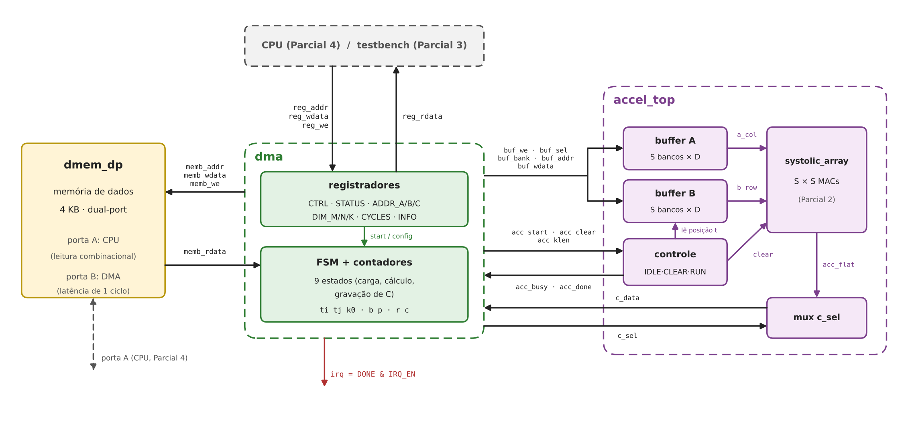
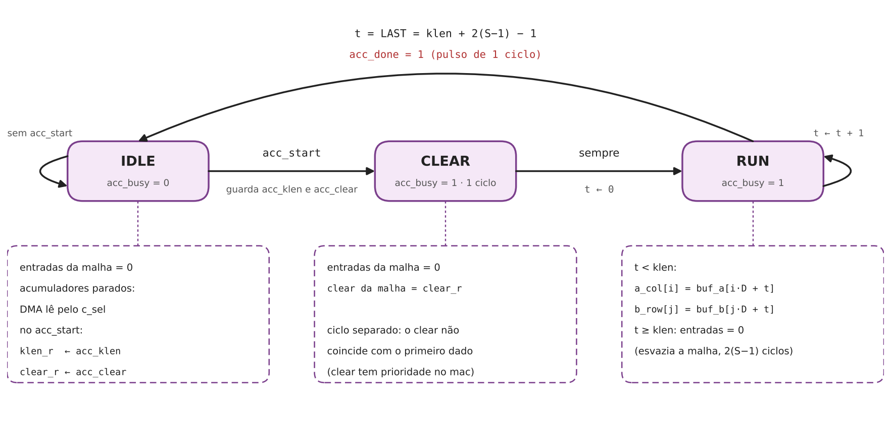
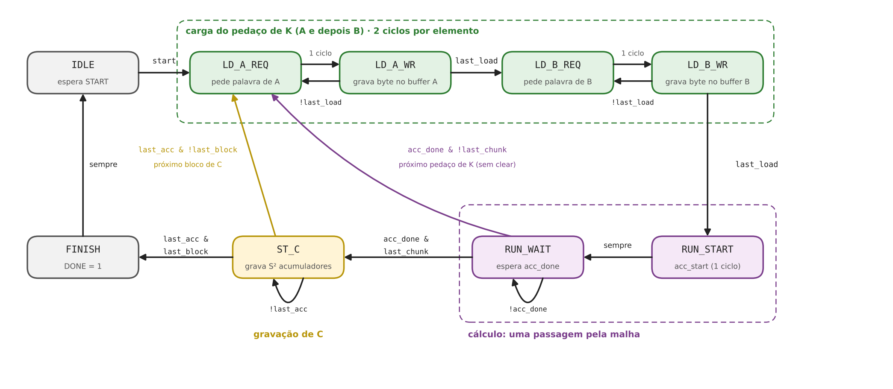

# Especificação do DMA e da memória compartilhada

[← voltar ao README](../README.md)

Este documento descreve a implementação RTL da infraestrutura de movimentação de dados: a
memória de dados dual-port, o *wrapper* do acelerador (buffers e controle da malha) e o
controlador de DMA. A visão do sistema (mapa de memória, registradores, protocolo e tiling)
está em [`especificacao.md`](especificacao.md), e a malha sistólica em
[`acelerador.md`](acelerador.md).

| Módulo | Arquivo | Função |
|---|---|---|
| `dmem_dp` | [`rtl/mem/dmem_dp.v`](../rtl/mem/dmem_dp.v) | memória de dados de 4 KB com duas portas: CPU (porta A) e DMA (porta B) |
| `accel_top` | [`rtl/accel/accel_top.v`](../rtl/accel/accel_top.v) | buffers de A e B, controle de uma passagem pela malha e leitura dos acumuladores |
| `dma` | [`rtl/dma/dma.v`](../rtl/dma/dma.v) | registradores de configuração e FSM que executa o tiling completo de `C = A × B` |

## Visão geral



O DMA não calcula: ele **copia** os elementos de A e B da memória para os buffers do
acelerador, **dispara** a malha, **lê** os acumuladores e **grava** C na memória, repetindo
esses passos para cada bloco de C e cada pedaço de K. A CPU apenas escreve a configuração
nos registradores e dá a partida.

### Parâmetros

| Parâmetro | Padrão | Significado |
|---|---|---|
| `ARRAY_SIZE` | 4 | dimensão da malha (`S`) |
| `DATA_W` | 8 | largura dos elementos de A e B (int8) |
| `ACC_W` | 32 | largura dos acumuladores e dos elementos de C (int32) |
| `BUF_DEPTH` | 16 | posições de cada banco dos buffers (`D`): tamanho máximo de um pedaço de K |

O barramento de registradores e a memória têm largura fixa de 32 bits (largura da CPU),
independente de `ACC_W`.

## Módulo `dmem_dp`

Memória de dados compartilhada de 4 KB, organizada em bytes (`reg [7:0] mem [0:4095]`).

| Porta | Direção | Largura | Descrição |
|---|---|---|---|
| `clk` | entrada | 1 | relógio |
| `a` | entrada | 32 | porta A: endereço em bytes (usa `a[11:0]`) |
| `wd` | entrada | 32 | porta A: dado de escrita |
| `we` | entrada | 1 | porta A: habilita escrita |
| `mode` | entrada | 3 | porta A: largura e sinal do acesso (mesma codificação da `dmem` original) |
| `rd` | saída | 32 | porta A: dado lido |
| `memb_addr` | entrada | 10 | porta B: endereço de **palavra** (0 a 1023) |
| `memb_wdata` | entrada | 32 | porta B: dado de escrita |
| `memb_we` | entrada | 1 | porta B: habilita escrita |
| `memb_rdata` | saída | 32 | porta B: palavra lida, disponível no ciclo seguinte |

- **Porta A (CPU):** mesma lógica da `dmem` original do processador, para que na integração
  baste trocar o módulo. Leitura **combinacional** (LW, LH, LHU, LB, LBU), exigida pela CPU
  single-cycle, e escrita síncrona por largura (SW, SH, SB). Só os 12 bits baixos do
  endereço são usados, de forma que acessos da CPU a outras regiões (como os registradores
  em `0x0001_0000`) não indexem posições inexistentes.
- **Porta B (DMA):** acesso por palavra de 32 bits. O byte de endereço `4·memb_addr + j` vai
  para os bits `[8j+7:8j]` (**little-endian**, mesmo formato do golden model). A leitura é
  **registrada**: o DMA apresenta o endereço num ciclo e recebe a palavra no seguinte.
- **Sem reset de conteúdo.** Diferente da `dmem` original, a memória não é zerada no reset:
  memórias reais (SRAM) não têm essa função, a zeragem de 4096 bytes custaria área na
  síntese, e o reset apagaria os dados pré-carregados pelo testbench.
- **Escritas simultâneas:** as duas escritas estão no mesmo `always`, com a porta B depois
  da porta A. Se as duas portas escreverem no mesmo endereço no mesmo ciclo, prevalece a
  porta B. No sistema isso não ocorre: o DMA escreve apenas na região de C, e a CPU não
  acessa a memória enquanto o DMA está ocupado.

## Módulo `accel_top`

*Wrapper* em volta da `systolic_array`: guarda os dados carregados pelo DMA, alimenta a
malha durante uma passagem e entrega os acumuladores um por vez.

| Porta | Direção | Largura | Descrição |
|---|---|---|---|
| `clk`, `rst` | entrada | 1 | relógio e reset assíncrono |
| `buf_we` | entrada | 1 | grava `buf_wdata` num buffer |
| `buf_sel` | entrada | 1 | 0 = buffer A, 1 = buffer B |
| `buf_bank` | entrada | `log₂(S)` | banco: linha de A ou coluna de B |
| `buf_addr` | entrada | `log₂(D)` | posição dentro do banco (índice no pedaço de K) |
| `buf_wdata` | entrada | `DATA_W` | elemento a gravar |
| `acc_start` | entrada | 1 | pulso: inicia uma passagem |
| `acc_clear` | entrada | 1 | lido junto com `acc_start`: zera os acumuladores antes da passagem |
| `acc_klen` | entrada | `log₂(D)+1` | quantos elementos de K há nos buffers (1 a `D`) |
| `acc_busy` | saída | 1 | passagem em andamento |
| `acc_done` | saída | 1 | pulso de 1 ciclo: fim da passagem, acumuladores prontos |
| `c_sel` | entrada | `log₂(S²)` | índice do acumulador a ler (`i·S + j`) |
| `c_data` | saída | `ACC_W` | acumulador selecionado |

### Buffers

Dois vetores (`buf_a` e `buf_b`) de `S × D` elementos. O banco `b`, posição `p`, fica no
índice `b·D + p`. O banco `i` do buffer A guarda o pedaço atual da **linha i de A**; o banco
`j` do buffer B guarda o pedaço atual da **coluna j de B**. A escrita é síncrona; a leitura é
combinacional, feita em paralelo em todos os bancos.

### Controle de uma passagem



- **IDLE:** aguarda o `acc_start` e guarda `acc_klen` e `acc_clear` em registradores.
- **CLEAR:** um ciclo com as entradas da malha em zero; se `acc_clear` estava ativo, o
  `clear` da malha é ligado neste ciclo. Separar o `clear` do primeiro dado evita que o
  produto daquele ciclo seja descartado (o `clear` tem prioridade sobre a soma no `mac`).
- **RUN:** o contador `t` percorre a passagem. Enquanto `t < klen`, a posição `i` de `a_col`
  recebe `buf_a[i·D + t]` e a posição `j` de `b_row` recebe `buf_b[j·D + t]` — a coluna `t` do
  pedaço de A e a linha `t` do pedaço de B. Depois, zeros por `2(S−1)` ciclos para esvaziar a
  malha. Na borda em que `t` atinge o último valor, o último par entra no MAC (`S−1`, `S−1`);
  nessa mesma borda a FSM volta a IDLE e liga `acc_done`.

A latência de uma passagem, do `acc_start` ao `acc_done`, é de **`1 + klen + 2(S−1)` ciclos**.

### Saída

`c_data = acc_flat[c_sel·ACC_W +: ACC_W]` (multiplexador combinacional).

### Regras do handshake

1. `acc_start` só é aceito em IDLE (`acc_busy = 0`).
2. Os buffers não devem ser alterados enquanto `acc_busy = 1`.
3. Após o `acc_done`, os acumuladores permanecem estáveis até o próximo `acc_start` (as
   entradas da malha ficam em zero em IDLE), e podem ser lidos pelo `c_sel`.

## Módulo `dma`

### Portas

| Grupo | Sinal | Direção | Largura | Descrição |
|---|---|---|---|---|
| sistema | `clk`, `rst` | entrada | 1 | relógio e reset assíncrono |
| | `irq` | saída | 1 | `DONE & IRQ_EN` |
| registradores | `reg_addr` | entrada | 8 | offset do registrador (dentro de `0x0001_0000`) |
| | `reg_wdata` | entrada | 32 | dado de escrita |
| | `reg_we` | entrada | 1 | habilita escrita |
| | `reg_rdata` | saída | 32 | dado lido (combinacional) |
| memória | `memb_addr`, `memb_wdata`, `memb_we`, `memb_rdata` | — | — | porta B da `dmem_dp` |
| acelerador | `buf_*`, `acc_start`, `acc_clear`, `acc_klen`, `c_sel`, `acc_busy`, `acc_done`, `c_data` | — | — | interface do `accel_top` |

A interface de registradores (`reg_*`) é a que liga o DMA ao decodificador de endereços da
CPU: na integração, `reg_we = dbus_we & dbus_addr[16]` e `reg_addr = dbus_addr[7:0]`. Cada
`sw` da CPU escreve um registrador; no testbench, a task `reg_write` cumpre esse papel.

### Registradores

| Offset | Nome | Escrita | Leitura |
|---|---|---|---|
| `0x00` | CTRL | bit 1 → IRQ_EN; bit 0 = 1 → pulso de START (ignorado se ocupado) | `{IRQ_EN, 0}` |
| `0x04` | STATUS | bit 1 = 1 → limpa DONE (*write-1-to-clear*) | `{DONE, BUSY}` |
| `0x08` / `0x0C` / `0x10` | ADDR_A / ADDR_B / ADDR_C | endereço base (bytes) | valor |
| `0x14` / `0x18` / `0x1C` | DIM_M / DIM_N / DIM_K | dimensão | valor |
| `0x20` | CYCLES | — | ciclos da última operação (do START ao fim) |
| `0x24` | INFO | — | `ARRAY_SIZE` |

- **BUSY** = FSM fora do estado IDLE.
- **DONE** é ligado pela FSM no estado FINISH e permanece em 1 até a escrita W1C. Se a
  escrita W1C coincidir com o fim de uma operação, prevalece o DONE.
- **CYCLES** é zerado no START e incrementado enquanto BUSY = 1.
- A ordem esperada de configuração é: ADDR_A/B/C e DIM_M/N/K, e por último CTRL.START.

### Contadores e endereços

Os contadores fazem o papel dos laços do tiling:

| Contador | Significado |
|---|---|
| `ti`, `tj` | linha e coluna do bloco de C atual (passo `S`) |
| `k0` | início do pedaço atual de K (passo `D`) |
| `b`, `p` | banco e posição sendo carregados |
| `r`, `c` | linha e coluna do acumulador sendo gravado |
| `off_r` | byte da palavra a extrair, guardado no ciclo de requisição |

Tamanho do pedaço atual: `klen = min(D, DIM_K − k0)`.

Endereços em bytes (formato da especificação):

| Elemento | Endereço |
|---|---|
| `A[ti+b][k0+p]` | `ADDR_A + (ti+b)·K + (k0+p)` |
| `B[k0+p][tj+b]` | `ADDR_B + (k0+p)·N + (tj+b)` |
| `C[ti+r][tj+c]` | `ADDR_C + 4·((ti+r)·N + tj + c)` |

Os bits `[11:2]` do endereço formam o `memb_addr`; os bits `[1:0]` indicam qual dos quatro
bytes da palavra lida contém o elemento int8.

### Máquina de estados



| Estado | Saídas | Atualização dos contadores | Próximo estado |
|---|---|---|---|
| IDLE | — | no `start`: zera todos | `LD_A_REQ` se `start` |
| LD_A_REQ | `memb_addr` = palavra de A | `off_r` ← byte do endereço | `LD_A_WR` |
| LD_A_WR | `buf_we`, `buf_sel = 0`, `buf_bank = b`, `buf_addr = p`, `buf_wdata` = byte `off_r` de `memb_rdata` | avança `p` e `b` | `LD_B_REQ` se `last_load`, senão `LD_A_REQ` |
| LD_B_REQ | `memb_addr` = palavra de B | `off_r` ← byte do endereço | `LD_B_WR` |
| LD_B_WR | idem, com `buf_sel = 1` | avança `p` e `b` | `RUN_START` se `last_load`, senão `LD_B_REQ` |
| RUN_START | `acc_start = 1`, `acc_clear = (k0 = 0)`, `acc_klen = klen` | — | `RUN_WAIT` |
| RUN_WAIT | — | no `acc_done`, se não for o último pedaço: `k0 += D` | no `acc_done`: `ST_C` se `last_chunk`, senão `LD_A_REQ` |
| ST_C | `c_sel = r·S + c`, `memb_addr` = palavra de C, `memb_we = 1`, `memb_wdata = c_data` | avança `c` e `r`; no último acumulador, avança o bloco (`tj`, `ti`) e zera `k0` | se `last_acc`: `FINISH` se `last_block`, senão `LD_A_REQ` |
| FINISH | — (DONE é ligado nos registradores) | — | `IDLE` |

Condições de fim de laço:

| Sinal | Condição | Significado |
|---|---|---|
| `last_load` | `p = klen−1` e `b = S−1` | último elemento de A (ou B) do pedaço |
| `last_chunk` | `k0 + D ≥ DIM_K` | último pedaço de K |
| `last_acc` | `r = S−1` e `c = S−1` | último acumulador do bloco |
| `last_block` | `ti + S ≥ DIM_M` e `tj + S ≥ DIM_N` | último bloco de C |

**Carga em dois ciclos por elemento.** Como a porta B tem um ciclo de latência e cada
palavra contém quatro elementos int8, cada elemento é carregado por um par de estados: no
REQ o endereço da palavra vai para a memória e o offset do byte é guardado; no WR a palavra
já está disponível e o byte correspondente é gravado no buffer.

**Clear apenas no primeiro pedaço.** `acc_clear = (k0 = 0)`: a primeira passagem de cada
bloco zera os acumuladores, e as seguintes somam sobre o resultado parcial (tiling em K).

### Desempenho

Pela estrutura da FSM, o número de ciclos de uma operação é:

```
passagem (um pedaço de K):  4·S·klen          (carga de A e B, 2 ciclos por elemento)
                          + klen + 2(S−1) + 3  (disparo, CLEAR, passagem pela malha, acc_done)
bloco de C:                 Σ passagens + S²   (gravação dos acumuladores)
operação:                   Σ blocos + 1       (FINISH)
```

O modelo coincide com o registrador CYCLES medido nos três testes (seção Verificação). A
maior parte do tempo é gasta na carga dos buffers: no caso 8×8×24 com S = 4, a carga ocupa
1536 dos 1769 ciclos (87%); os outros 233 são disparo, passagens pela malha, gravação de C e FINISH. Carregar mais de um
elemento por ciclo (por exemplo, os quatro bytes de cada palavra lida) é a principal
oportunidade de otimização.

## Verificação

Cada módulo tem um testbench unitário auto-verificável, executado no Xcelium a partir de
`sim/`.

| Teste | Comando | O que verifica |
|---|---|---|
| [`tb_dmem_dp`](../verif/unit/mem/tb_dmem_dp.v) | `make mem` | escrita pela porta B e leitura pela A (LW, LB, LBU, ordem little-endian); escrita pela A (SW, SB) e leitura pela B; latência de 1 ciclo da porta B; uso de `a[11:0]` |
| [`tb_accel_top`](../verif/unit/accel/tb_accel_top.v) | `make accel-top` | carga dos buffers pela interface `buf_*`; latência `1 + klen + 2(S−1)`; `acc_done` de 1 ciclo; leitura dos acumuladores pelo `c_sel`; K em uma e em duas passagens (S = 2 e 4) |
| [`tb_dma`](../verif/unit/dma/tb_dma.v) | `make dma` | DMA + memória + acelerador sem CPU (ver abaixo) |

### Testbench do DMA

O testbench faz o papel da CPU, configurando o DMA pela task `reg_write` (*bus functional
model*):

1. pré-carrega a memória com `dmem_init.hex` (A e B), por acesso hierárquico;
2. escreve ADDR_A/B/C e DIM_M/N/K, e por último CTRL = START + IRQ_EN;
3. espera o `irq`, com limite de ciclos (em caso de travamento, informa o estado da FSM);
4. confere STATUS (DONE = 1, BUSY = 0) e lê CYCLES;
5. compara as 1024 palavras da memória com `dmem_expected.hex` — o que detecta tanto um C
   errado quanto escritas fora da região de C;
6. escreve 1 no bit DONE do STATUS e confere que DONE e `irq` voltam a zero.

Vetores gerados pelo golden model ([`model/matmul_tiled.py`](../model/matmul_tiled.py)):

```sh
python model/matmul_tiled.py --m 2 --n 2 --k 8  --s 2 --seed 1 --out verif/unit/dma/vec_dma_basic
python model/matmul_tiled.py --m 4 --n 4 --k 24 --s 2 --seed 1 --out verif/unit/dma/vec_dma_tiled
python model/matmul_tiled.py --m 8 --n 8 --k 24 --s 4 --seed 2 --out verif/unit/dma/vec_dma_tiled_s4
```

| Alvo | M × N × K | S | Blocos de C | Passagens | O que exercita | CYCLES | Resultado |
|---|---|---|---|---|---|---|---|
| `make dma-basic` | 2 × 2 × 8 | 2 | 1 | 1 | caminho mais simples | 82 | ✅ |
| `make dma-tiled` | 4 × 4 × 24 | 2 | 4 | 8 | tiling em M, N e K; último pedaço menor (16 + 8); clear só no primeiro pedaço | 921 | ✅ |
| `make dma-tiled-s4` | 8 × 8 × 24 | 4 | 4 | 8 | o mesmo, com malha 4×4 | 1769 | ✅ |

Os três passam com as 1024 palavras da memória conferindo com o golden model.
