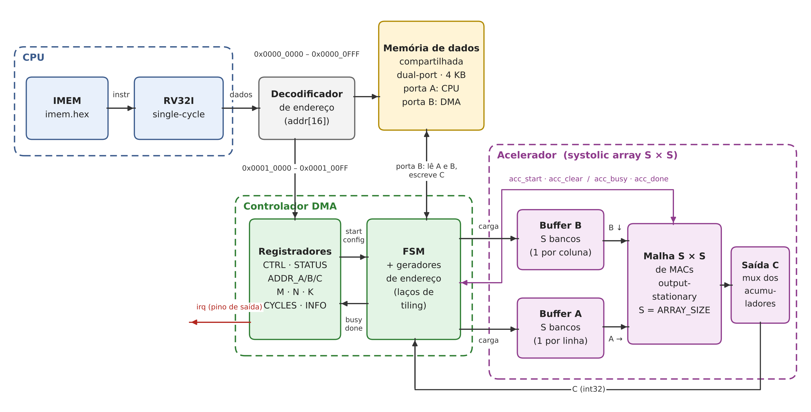

# Especificação do sistema

[← voltar ao README](../README.md)

A CPU configura os registradores do DMA e dispara a operação. A partir daí, o DMA lê A e B da memória, alimenta a malha sistólica bloco a bloco e grava C de volta, sinalizando o fim pelo bit DONE do STATUS e pelo pino `irq`.



## Parâmetros

| Parâmetro | Valor padrão | Significado |
|---|---|---|
| `ARRAY_SIZE` (S) | 4 | Dimensão da malha sistólica (S × S MACs). Sintetizado com 2, 4 e 8 |
| `BUF_DEPTH` (D) | 16 | Profundidade de cada banco dos buffers locais (tamanho do bloco de K) |
| `DATA_W` | 8 | Largura dos elementos de A e B (int8 com sinal) |
| `ACC_W` | 32 | Largura dos acumuladores e dos elementos de C (int32 com sinal) |
| `MEM_BYTES` | 4096 | Tamanho da memória de dados compartilhada |

## Decisões de projeto

| Decisão | Escolha | Justificativa |
|---|---|---|
| Compartilhamento da memória | Memória dual-port: porta A para a CPU, porta B para o DMA (sem arbitragem) | Elimina conflitos de acesso e dispensa lógica de *stall* na CPU single-cycle |
| Formato dos dados | Operandos int8, acumulador de 32 bits — sem overflow para K < 2¹⁷, pois \|produto\| ≤ 2¹⁴ | 4 elementos por acesso à memória (contra 1 com int32); acumulador de 32 bits sem overflow |
| Tipo de malha | *Output-stationary*: cada MAC acumula um elemento de C | Permite K maior que o buffer sem guardar somas parciais fora da malha, o que simplifica o DMA |
| Sinalização de término | Bit DONE do STATUS (lido pela CPU em laço) e pino `irq` — a ISA implementada (RV32I sem Zicsr) não trata interrupções | Cumpre os requisitos do projeto sem alterar a arquitetura interna da CPU |
| Dimensões suportadas | M, N e K múltiplos de 8 (válido para as três configurações) | Garante tiling exato (2x2, 4x4, 8x8), alinhamento de memória e DMA sem zero-padding |

## Mapa de memória

| Faixa de endereços | Região |
|---|---|
| `0x0000_0000 – 0x0000_03FF` | Dados gerais da CPU |
| `0x0000_0400 – 0x0000_07FF` | Matriz A (posição padrão dos testes) |
| `0x0000_0800 – 0x0000_0BFF` | Matriz B (posição padrão dos testes) |
| `0x0000_0C00 – 0x0000_0FFF` | Matriz C (posição padrão dos testes) |
| `0x0001_0000 – 0x0001_00FF` | Registradores do DMA / acelerador |

Arquitetura Harvard: a memória de instruções (imem.hex) é isolada e não entra neste mapa. A memória de dados usa o bit addr[16] para decodificar a região:

- `0x0000_0000 – 0x0000_0FFF`: RAM Compartilhada (4 KB).
- `0x0001_0000 – 0x0001_00FF`: Registradores do DMA/Acelerador.

Regras e Formatos:

- **Endereçamento Flexível:** Os endereços de A, B e C na tabela são padrões de teste; os locais reais são configurados via registradores ADDR_A/B/C.
- **Matrizes A e B (int8):** Row-major, little-endian, 4 elementos/palavra (32 bits). Posição: A[i][k] em `ADDR_A + i·K + k`; B[k][j] em `ADDR_B + k·N + j`.
- **Matriz C (int32):** Row-major, 1 elemento/palavra (32 bits). Posição: C[i][j] em `ADDR_C + 4·(i·N + j)`.
- **Capacidade (1 KB/matriz):** Suporta A e B até 32 x 32 e C até 16 x 16 (dimensão usada nos testes).

## Registradores (base `0x0001_0000`)

| Offset | Nome | Acesso | Descrição |
|---|---|---|---|
| `0x00` | CTRL | E | bit 0 START (escrever 1 inicia a operação); bit 1 IRQ_EN (habilita o pino `irq`) |
| `0x04` | STATUS | L / E1C | bit 0 BUSY (operação em andamento); bit 1 DONE (operação concluída — permanece em 1 até a CPU escrever 1 nesse bit) |
| `0x08` | ADDR_A | L/E | Endereço base da matriz A |
| `0x0C` | ADDR_B | L/E | Endereço base da matriz B |
| `0x10` | ADDR_C | L/E | Endereço base da matriz C |
| `0x14` | DIM_M | L/E | Número de linhas de A e de C |
| `0x18` | DIM_N | L/E | Número de colunas de B e de C |
| `0x1C` | DIM_K | L/E | Colunas de A / linhas de B |
| `0x20` | CYCLES | L | Ciclos de clock gastos na última operação (START → DONE) |
| `0x24` | INFO | L | Valor de `ARRAY_SIZE` sintetizado |

L = leitura, E = escrita, E1C = escrever 1 para limpar. Acesso somente por palavra (`lw`/`sw`).

## Sinais de interface

**CPU → decodificador de endereço** (barramento de dados do `riscv_top`)

| Sinal | Direção (CPU) | Largura | Descrição |
|---|---|---|---|
| `dbus_addr` | saída | 32 | Endereço (resultado da ULA) |
| `dbus_wdata` | saída | 32 | Dado de escrita (rs2) |
| `dbus_we` | saída | 1 | Habilita escrita |
| `dbus_mode` | saída | 3 | Largura/sinal do acesso (byte, meia palavra, palavra) |
| `dbus_rdata` | entrada | 32 | Dado lido (da memória ou dos registradores) |

**DMA ↔ memória compartilhada (porta B)**

| Sinal | Direção (DMA) | Largura | Descrição |
|---|---|---|---|
| `memb_addr` | saída | 10 | Endereço de palavra (4 KB / 4 bytes) |
| `memb_wdata` | saída | 32 | Dado de escrita (elemento de C) |
| `memb_we` | saída | 1 | Habilita escrita |
| `memb_rdata` | entrada | 32 | Dado lido (4 elementos de A ou B); latência de 1 ciclo |

**DMA → buffers locais do acelerador**

| Sinal | Direção (DMA) | Largura | Descrição |
|---|---|---|---|
| `buf_we` | saída | 1 | Habilita escrita no buffer |
| `buf_sel` | saída | 1 | 0 = Buffer A, 1 = Buffer B |
| `buf_bank` | saída | log₂(S) | Banco: linha de A ou coluna de B |
| `buf_addr` | saída | log₂(D) | Posição dentro do banco (índice em K) |
| `buf_wdata` | saída | 8 | Elemento int8 |

**DMA ↔ acelerador (controle e resultado)**

| Sinal | Direção (DMA) | Largura | Descrição |
|---|---|---|---|
| `acc_start` | saída | 1 | Requisição: pulso que inicia uma passagem pela malha |
| `acc_clear` | saída | 1 | Zera os acumuladores (1ª passagem de cada bloco de C) |
| `acc_klen` | saída | log₂(D)+1 | Quantos elementos de K há nos buffers nesta passagem |
| `acc_busy` | entrada | 1 | Ocupado: malha processando |
| `acc_done` | entrada | 1 | Conclusão: pulso no fim da passagem |
| `c_sel` | saída | log₂(S²) | Seleciona qual acumulador ler |
| `c_data` | entrada | 32 | Valor do acumulador selecionado |

**Saída do sistema**

| Sinal | Largura | Descrição |
|---|---|---|
| `irq` | 1 | Vai a 1 quando DONE = 1 e IRQ_EN = 1 |

## Protocolo de operação

A CPU apenas configura e dispara; as etapas 3 a 5 ocorrem de forma 100% autônoma pelo DMA.

1. **Configuração:** CPU grava ADDR_A/B/C e dimensões M, N, K via instruções sw.
2. **Disparo:** CPU faz CTRL.START = 1 (STATUS.BUSY vira 1).
3. **Carga:** DMA lê blocos de A e B da memória (Porta B) para os buffers do acelerador.
4. **Processamento:** DMA aciona acc_start (acc_clear na 1ª passagem); a malha processa e sinaliza com acc_done. (Passos 3 e 4 repetem por bloco de K).
5. **Gravação:** DMA lê acumuladores (S^2) e grava o bloco de C na memória. (Retorna ao passo 3 até concluir C).
6. **Conclusão:** BUSY = 0, DONE = 1, registrador CYCLES é atualizado e o pino irq é acionado (se IRQ_EN = 1).
7. **Retomada:** CPU detecta DONE = 1 por polling, limpa o bit e encerra a espera.

## Tiling

```
para cada bloco (ti, tj) de C, de tamanho S × S:
    acc_clear
    para cada bloco de K, de tamanho até D:
        DMA carrega A[ti : ti+S, k : k+D] no Buffer A   (um banco por linha)
        DMA carrega B[k : k+D, tj : tj+S] no Buffer B   (um banco por coluna)
        acc_start  →  espera acc_done
    DMA lê os S² acumuladores e grava C[ti : ti+S, tj : tj+S]
```

O tiling permite processar matrizes maiores que a malha física calculando blocos S x S de C por vez.

Arquitetura Output-Stationary:

- **Fluxo e Reuso:** Cada MAC (i, j) fixa um acumulador para o elemento C[i][j]. A cada ciclo, multiplica as entradas, acumula e repassa A (direita) e B (baixo), permitindo que cada dado lido seja reusado por S MACs.
- **Atraso (Skew):** As entradas possuem atraso escalonado (linha i em i ciclos, coluna j em j ciclos) para alinhar A[i][k] e B[k][j] no tempo.
- **Latência:** Uma passagem pela malha exige D + 2 * (S - 1) ciclos.

Decisões de Projeto:

- **Bancos de Memória:** Buffers A e B são fatiados em S bancos independentes para entregar S valores em paralelo por ciclo aos MACs.
- **Suporte a K > D:** O acumulador só é zerado (acc_clear) no primeiro bloco de K; as passagens seguintes continuam somando na mesma posição até concluir o elemento de C.

**Desempenho da Malha (Matriz 16 x 16 x 16, D = 16)**

| ARRAY_SIZE (S x S) | Blocos de C | Ciclos na Malha |
|---|---|---|
| 2 x 2 | 64 | 1152 |
| 4 x 4 | 16 | 352 |
| 8 x 8 | 4 | 120 |

