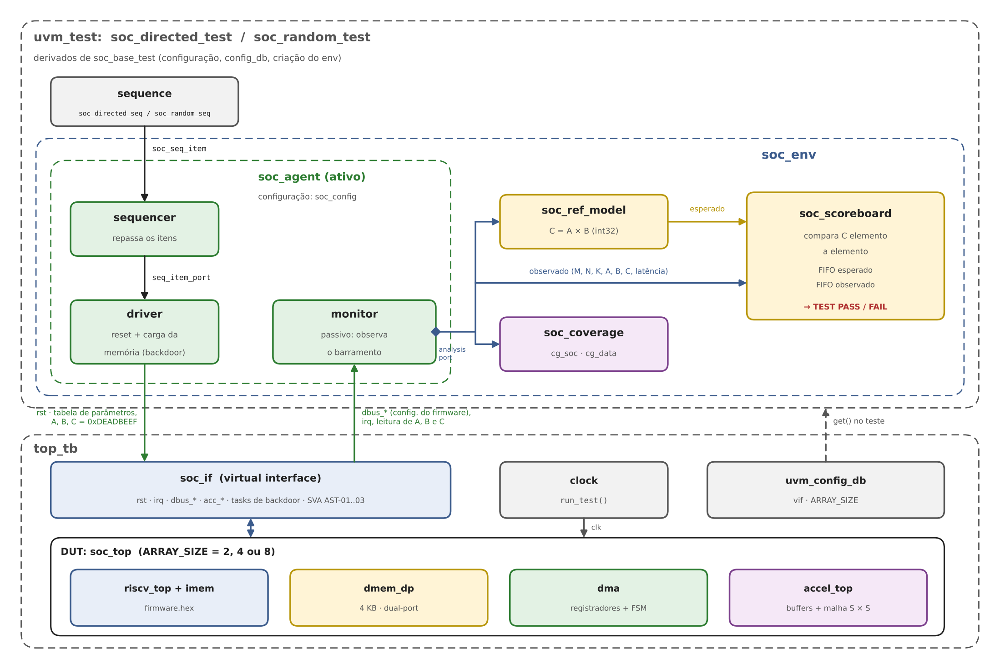

# Ambiente de verificação UVM

[← voltar ao README](../../README.md)

Ambiente UVM 1.2 (SystemVerilog) para o top-level do projeto, simulado no Cadence Xcelium.
Verifica, com checagem automática e cobertura funcional, que a multiplicação `C = A × B`
executada pelo sistema completo está correta para diferentes dimensões, dados e tamanhos de malha.

## DUT

O DUT é o `soc_top` ([`rtl/top/soc_top.v`](../../rtl/top/soc_top.v)): processador RISC-V RV32I,
memória de dados dual-port de 4 KB, controlador de DMA e acelerador com malha sistólica
`ARRAY_SIZE × ARRAY_SIZE`. Os únicos pinos funcionais são `clk`, `rst` e `irq`. A CPU executa o
firmware ([`sw/firmware/firmware.s`](../../sw/firmware/firmware.s)), que lê os parâmetros da
operação numa tabela em memória, programa os registradores do DMA, dispara a operação e espera o
fim (por polling do STATUS ou pelo pino `irq`). O DMA move A e B para o acelerador, acumula os
blocos de C e grava o resultado na memória de dados.

## Como o estímulo chega ao DUT

- **Estímulo = conteúdo da memória de dados.** O driver mantém o sistema em reset, escreve por
  backdoor a tabela de parâmetros, as matrizes A e B, e preenche a região de C com o marcador
  `0xDEADBEEF`. Depois libera o reset, e o firmware faz o resto. Os registradores do DMA são
  configurados **apenas pelo firmware**, sem `force` nem backdoor.
- **Firmware genérico.** Um único binário serve para qualquer operação, lendo esta tabela:

  | Endereço | Conteúdo |
  |---|---|
  | `0x000` | ADDR_A |
  | `0x004` | ADDR_B |
  | `0x008` | ADDR_C |
  | `0x00C` | M |
  | `0x010` | N |
  | `0x014` | K |
  | `0x018` | IRQ_EN (0 = polling, 1 = interrupção) |
  | `0x01C` | escrito com 1 pelo firmware ao terminar (usado no modo polling) |

- **Monitor passivo.** Observa o barramento interno da CPU (`dbus_*`) para saber o que o firmware
  configurou. Quando vê o START, lê A e B da memória (antes de o DMA trabalhar); no fim da
  operação (`irq` ou escrita em `0x01C`), lê C e mede a latência em ciclos. Nada vem do item do
  driver, de modo que erros do driver, do firmware ou do hardware aparecem no scoreboard.
- **Resposta esperada.** O reference model calcula `C = A × B` em 32 bits com sinal (mesma largura
  do acumulador do hardware) a partir das entradas observadas.

## Estrutura



O teste cria o `soc_env` e inicia a sequence. O driver carrega a memória por backdoor e libera o
reset; o firmware configura o DMA. O monitor observa o barramento e publica cada operação para o
reference model, o scoreboard e a cobertura.

```
verif/uvm/
├── agents/soc_agent/   agente: interface, transação, configuração, sequencer, driver,
│                       monitor, agente, sequences e pacote
├── env/                reference model, scoreboard, cobertura, env e pacote
├── tests/              teste base, testes derivados e pacote
└── top/                top_tb: clock, DUT, interface, config_db e run_test()
```

| Arquivo | Função |
|---|---|
| `agents/soc_agent/soc_if.sv` | interface: `rst`, `irq`, sinais internos observados (`dbus_*`, `acc_*`), tasks de backdoor da memória e assertions (SVA) |
| `agents/soc_agent/soc_seq_item.sv` | transação: M, N, K, endereços, IRQ_EN, A e B (`rand`, com constraints), C e latência (preenchidos pelo monitor) |
| `agents/soc_agent/soc_config.sv` | configuração do agente: virtual interface, `is_active`, `ARRAY_SIZE`, timeout |
| `agents/soc_agent/soc_sequencer.sv` | sequencer parametrizado com a transação |
| `agents/soc_agent/soc_driver.sv` | reset, carga da memória por backdoor, liberação do reset e espera do fim (com timeout) |
| `agents/soc_agent/soc_monitor.sv` | observação passiva: configuração pelo barramento, A e B no START, C no fim; publica no analysis port |
| `agents/soc_agent/soc_agent.sv` | cria e conecta sequencer, driver e monitor |
| `agents/soc_agent/soc_sequences.sv` | sequences dirigida (`soc_directed_seq`) e aleatória (`soc_random_seq`) |
| `agents/soc_agent/soc_agent_pkg.sv` | pacote do agente |
| `env/soc_ref_model.sv` | calcula o C esperado a partir de A e B observados e publica para o scoreboard |
| `env/soc_scoreboard.sv` | compara C elemento a elemento (linha, coluna, esperado e obtido), acusa operações pendentes e imprime o veredito |
| `env/soc_coverage.sv` | cobertura funcional (`uvm_subscriber` ligado ao monitor) |
| `env/soc_env.sv`, `env/soc_env_pkg.sv` | criação e conexões TLM dos componentes; pacote |
| `tests/soc_base_test.sv` | teste base: configuração, `config_db`, criação do env, impressão da topologia |
| `tests/soc_directed_test.sv`, `tests/soc_random_test.sv` | testes derivados (ver tabela abaixo) |
| `tests/soc_tests_pkg.sv` | pacote dos testes |
| `top/top_tb.sv` | top do testbench |

Arquivos de suporte: [`sim/filelists/uvm.f`](../../sim/filelists/uvm.f) (lista de compilação),
[`sim/Makefile`](../../sim/Makefile) (alvos `uvm*`) e
[`sw/firmware/`](../../sw/firmware/) (fonte e `.hex` do firmware).

## Como rodar

Todos os comandos rodam de dentro de `sim/`, no servidor com o Xcelium.

```sh
cd sim
make clean                                   # remove artefatos (xcelium.d, cov_work, logs)
make uvm                                     # teste dirigido, ARRAY_SIZE = 4, seed 1
make uvm UVM_TEST=soc_random_test SEED=7     # teste aleatório com outra seed
make uvm ARRAY_SIZE=8                        # outra configuração da malha (2, 4 ou 8)
make uvm-waves                               # grava formas de onda e abre o SimVision
make uvm-err                                 # injeta uma falha no RTL (deve terminar em TEST FAIL)
make uvm-regress                             # regressão completa
make cov-merge                               # cobertura acumulada da regressão (IMC)
```

| Variável | Padrão | Significado |
|---|---|---|
| `UVM_TEST` | `soc_directed_test` | teste a executar (`+UVM_TESTNAME`) |
| `ARRAY_SIZE` | `4` | tamanho da malha (2, 4 ou 8) |
| `SEED` | `1` | semente da randomização (`-svseed`); a mesma seed reproduz os mesmos casos |
| `REGRESS_SEEDS` | `1 7 42 123 2026` | seeds usadas pelo teste aleatório na regressão |
| `COV` | `1` | coleta de cobertura (`1` liga, `0` desliga); ex.: `make uvm COV=0` |

O número de operações do teste aleatório pode ser alterado com o plusarg `+NTXNS=<n>` (padrão 15).

Cada execução gera `uvm_<teste>_s<ARRAY_SIZE>_seed<SEED>.log`, que termina com o resumo do
scoreboard, a contagem de `UVM_ERROR`/`UVM_FATAL` e o veredito `TEST PASS` ou `TEST FAIL`.
A regressão gera também `regress_summary.log`, com o veredito e a cobertura de cada execução.

## Testes

| Teste | Operações | O que verifica | Resultado esperado |
|---|---|---|---|
| `soc_directed_test` | 7 | (1) um bloco S × S com K = 8, polling; (2) 8 × 8 × 24: tiling em M, N e K, com `irq`; (3) pior caso, todos os elementos −128 com K = 17 (dois pedaços de K); (4) matriz zero com K = 1; (5–7) fronteiras do tiling em K: K = 16 (buffer cheio), 32 (dois pedaços cheios) e 33 (terceiro pedaço com um elemento) | `TEST PASS`, 7 operações corretas |
| `soc_random_test` | 15 (`+NTXNS`) | dimensões e dados aleatórios: M e N múltiplos de `ARRAY_SIZE` (2 a 16), K de 1 a 36, matrizes não quadradas, polling e `irq`; extremos (−128, 0, 127) com ~10% de chance cada | `TEST PASS`, todas as operações corretas |
| `make uvm-err` | 7 | `soc_directed_test` com `+define+INJECT_BUG`, que faz o DMA gravar o primeiro elemento de cada bloco de C com +1 | `TEST FAIL`, com o scoreboard apontando cada elemento divergente |

A regressão (`make uvm-regress`) executa o teste dirigido com `ARRAY_SIZE` = 2, 4 e 8 e o teste
aleatório com as 5 seeds em cada tamanho: 18 execuções, todas com `TEST PASS` esperado.

## Checagem automática

- **Scoreboard:** compara cada elemento de C com o esperado e reporta divergências com
  `` `uvm_error `` (operação, dimensões, linha, coluna, valor esperado e obtido). No
  `check_phase`, acusa operações sem par entre observado e esperado.
- **Assertions** (na interface):

  | ID | Propriedade |
  |---|---|
  | AST-01 | `acc_start` ⇒ `acc_busy` no ciclo seguinte |
  | AST-02 | `acc_done` dura exatamente 1 ciclo |
  | AST-03 | a CPU não escreve na região de C enquanto o acelerador está ocupado (autonomia do DMA) |

- **Marcador em C:** a região de C é preenchida com `0xDEADBEEF` antes de cada operação, para que
  um elemento não gravado pelo DMA apareça como divergência.

## Cobertura funcional

Amostrada a partir das transações publicadas pelo monitor (`soc_coverage`):

| Coverpoint | Bins | Justificativa |
|---|---|---|
| `cp_array_size` | 2, 4, 8 | as três configurações da malha (fecha na cobertura acumulada da regressão) |
| `cp_k_blocks` | 1, 2, ≥ 3 passagens | tiling em K (`BUF_DEPTH` = 16) |
| `cp_k_boundary` | K = 1, 16, 17, 32, 33 | fronteiras do tiling em K: pedaço mínimo, buffer exatamente cheio e último pedaço com um único elemento |
| `cp_m_blocks`, `cp_n_blocks` | 1, ≥ 2 blocos | tiling em M e N (laços de blocos do DMA), medido em blocos para ser alcançável em qualquer configuração |
| `cp_irq_mode` | polling, irq | os dois modos de término |
| `cx_blocks_k_irq` | cross de blocos em M × passagens em K × término | combinações de tiling com os dois modos de término |
| `cp_val` (`cg_data`) | −128, 0, 127 | valores extremos de A e B (sinal e magnitude do acumulador) |

A coleta de cobertura é habilitada por padrão em `make uvm` (`-coverage all`) e pode ser desligada com `COV=0`. O percentual de cada
covergroup aparece no fim do log; os bancos de dados ficam em `sim/cov_work/`. Depois da
regressão, `make cov-merge` combina as 18 execuções no IMC ([`sim/merge_cov.tcl`](../../sim/merge_cov.tcl))
e imprime a cobertura acumulada. Resultado da regressão atual: **100% (32 de 32 bins)**.
